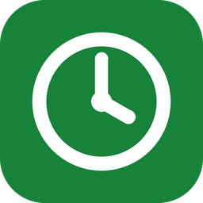
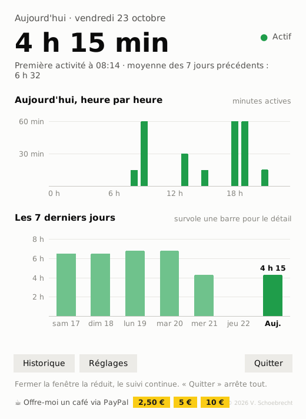
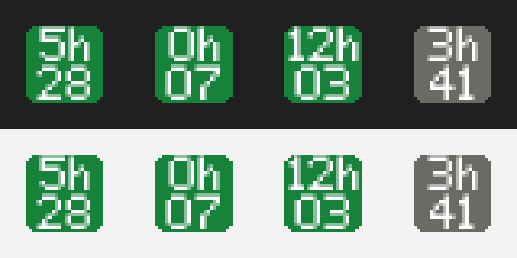
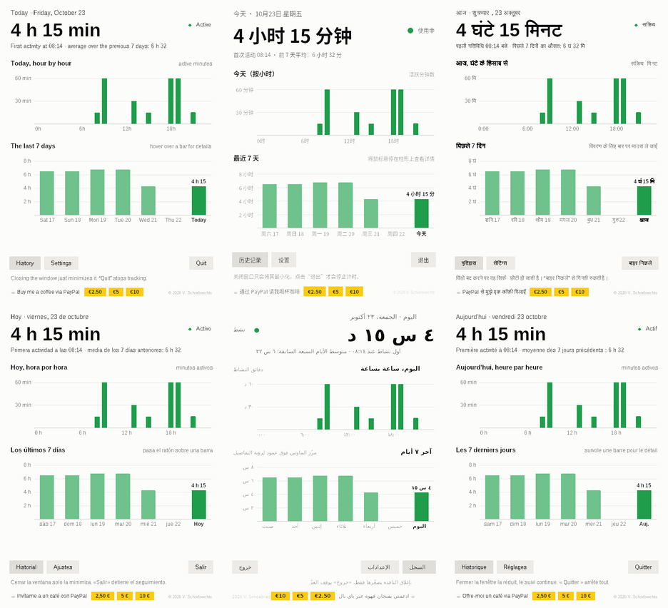
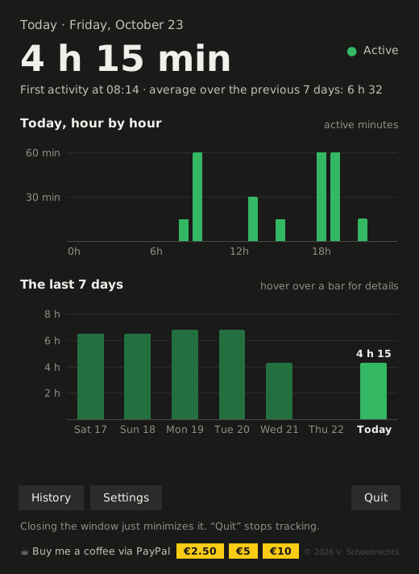
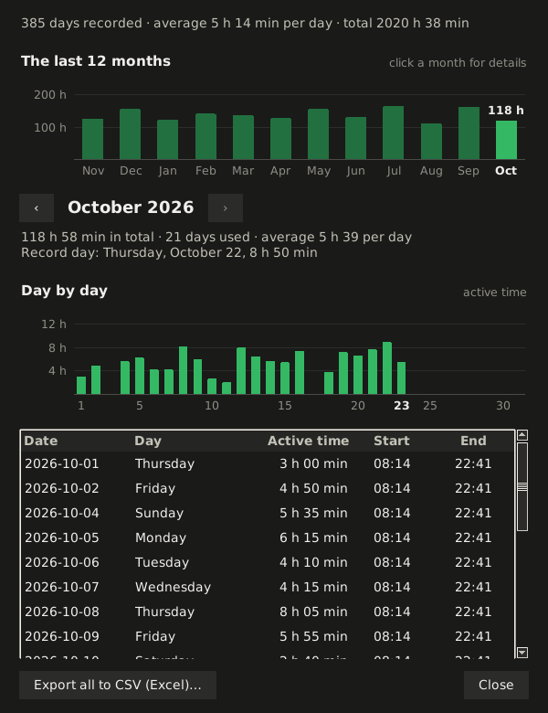

# PC Time

**Screen time for your Windows PC · Le temps d'écran de ton PC**

**Français** · [English](#english)

Petite application Windows gratuite qui compte le temps passé **chaque jour** sur l'ordinateur, comme le « temps d'écran » d'un téléphone. (Anciennement « Temps PC ».)

Seul le temps **actif** est compté : après quelques minutes sans souris ni clavier, le compteur se met en pause et retire ces minutes d'inactivité. La veille du PC n'est pas comptée non plus.

<p>
  
  
</p>

## Ce qu'elle fait

- Temps du jour en grand, graphique **heure par heure** et graphique des **7 derniers jours**. Survole une barre pour voir le détail.
- **Vert** quand tu utilises le PC, **gris** quand le compteur est en pause.
- L'icône dans la barre des tâches **affiche le temps du jour** (ex. « 5h » au-dessus de « 28 »), mise à jour chaque minute.
- **Historique** : histogramme des 12 derniers mois (clic sur un mois pour le détail), le mois choisi jour par jour, tableau des jours et export CSV pour Excel.
- En **6 langues** : anglais, chinois, hindi, espagnol, arabe et français (la langue de Windows, ou au choix dans Réglages).
- Démarrage automatique avec Windows (proposé au premier lancement, modifiable dans Réglages).
- Fermer la fenêtre la réduit, le suivi continue. Le bouton **Quitter** arrête tout.
- Gratuite. Le bouton « Offre-moi un café » (PayPal) permet de soutenir le projet. Une fois par mois, une petite ligne le rappelle, avec un bouton **Mise à jour** ; « C'est déjà fait ✓ » ou la croix la cache pour un mois.





## Installation

1. **[Télécharge PCTime.zip](https://github.com/vincentschoebrechts-beep/pc-time/raw/main/telechargement/PCTime.zip)** (Windows 10/11, 64 bits, environ 10 Mo).
2. Clic droit sur le zip → **Extraire tout…**, puis place le dossier `PCTime` là où il restera (par ex. Documents).
3. Double-clique sur `PCTime.exe`. Rien d'autre à installer.

Aussi sur itch.io : **[vsc4652.itch.io/pc-time](https://vsc4652.itch.io/pc-time)**

L'exe n'est pas signé : Windows peut afficher « Windows a protégé votre ordinateur ». Clique sur **Informations complémentaires**, puis **Exécuter quand même**.

**Nouvelles versions :** [greenserver.be/update](https://greenserver.be/update) (bouton « Rechercher une mise à jour » dans Réglages).

**Mise à jour (aussi depuis Temps PC) :** dans l'appli, clique sur **Quitter**, place le nouveau `PCTime.exe` **dans le même dossier** que l'ancien et lance-le. Le démarrage automatique passe tout seul sur `PCTime.exe`, tu peux ensuite supprimer l'ancien `TempsPC.exe`. Les données sont conservées.

## Données et vie privée

Tout reste sur le PC, dans `%APPDATA%\TempsPC\donnees.json` (bouton « Ouvrir le dossier » dans Réglages). Rien n'est envoyé sur Internet : le bouton de mise à jour ouvre juste une page web quand tu cliques dessus. Aucun compte n'est nécessaire.

Copies de sécurité automatiques dans `%APPDATA%\TempsPC\sauvegardes` : une par jour (les 14 dernières sont gardées) et une copie permanente avant chaque nouvelle version.

## Versions

- **1.5** : petit rappel « café » une fois par mois (après 3 h d'utilisation), bouton **Mise à jour** vers greenserver.be/update (aussi dans Réglages, avec le numéro de version).
- **1.4** : nouveau nom, **PC Time** (anciennement Temps PC). Données et réglages conservés.
- **1.3** : 6 langues (anglais, chinois, hindi, espagnol, arabe, français), bouton de don à 2,50 €.
- **1.2** : français / anglais, bouton « Offre-moi un café ».
- **1.1** : Historique avec histogrammes (12 derniers mois et mois jour par jour), copies de sécurité automatiques, fenêtres adaptées aux petits écrans.
- **1.0** : première version.

---

<a name="english"></a>

## English

Small free Windows app that counts the time you spend on your computer **each day**, like the “screen time” of a phone. (Formerly “Temps PC”.)

Only **active** time counts: after a few minutes without mouse or keyboard, the counter pauses and removes those idle minutes. Sleep time is not counted either.

<p>
  
  
</p>

### Features

- Today's time in large type, an **hour-by-hour** chart and a **last 7 days** chart. Hover over a bar for details.
- **Green** while you use the PC, **grey** when the counter is paused.
- The taskbar icon **shows today's time** (e.g. “5h” above “28”), updated every minute.
- **History**: last 12 months as a bar chart (click a month for details), the chosen month day by day, a table of days and CSV export for Excel.
- **6 languages**: English, Chinese, Hindi, Spanish, Arabic and French (same as Windows, or choose in Settings).
- Starts with Windows (offered on first launch, can be changed in Settings).
- Closing the window just minimizes it; tracking continues. **Quit** stops everything.
- Free. The “Buy me a coffee” button (PayPal) lets you support the project. Once a month, a small line reminds you, with an **Update** button; “Already done ✓” or the cross hides it for a month.

### Install

1. **[Download PCTime.zip](https://github.com/vincentschoebrechts-beep/pc-time/raw/main/telechargement/PCTime.zip)** (Windows 10/11, 64-bit, about 10 MB).
2. Right-click the zip → **Extract All…**, then put the `PCTime` folder where it will stay (e.g. Documents).
3. Double-click `PCTime.exe`. Nothing else to install.

Also on itch.io: **[vsc4652.itch.io/pc-time](https://vsc4652.itch.io/pc-time)**

The exe is not signed: Windows may show “Windows protected your PC”. Click **More info**, then **Run anyway**.

**New versions:** [greenserver.be/update](https://greenserver.be/update) (“Check for updates” button in Settings).

**Update (also from Temps PC):** in the app, click **Quit**, put the new `PCTime.exe` **in the same folder** as the old one and start it. Automatic startup switches to `PCTime.exe` by itself; you can then delete the old `TempsPC.exe`. Your data is kept.

### Data and privacy

Everything stays on the PC, in `%APPDATA%\TempsPC\donnees.json` (“Open folder” button in Settings). Nothing is sent over the Internet: the update button only opens a web page when you click it. No account is needed.

Automatic backups in `%APPDATA%\TempsPC\sauvegardes`: one per day (the last 14 are kept) and a permanent copy before each new version.

---

## Code source / Source code

Avec / with [Python 3](https://www.python.org/downloads/) : double-clic sur / double-click `pc_time.pyw`. Aucun module à installer / no extra module needed. Fonctionne aussi sur / also runs on macOS and Linux.

Construire l'exe / build the exe (Windows, Python installé / installed) :

```bat
construction\construire.bat
```

Résultat / output : `dist\PCTime.exe` (PyInstaller, un seul fichier / single file).
