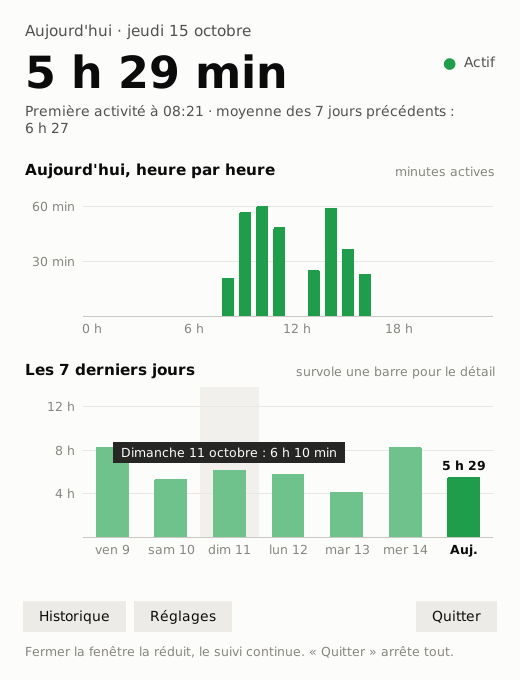
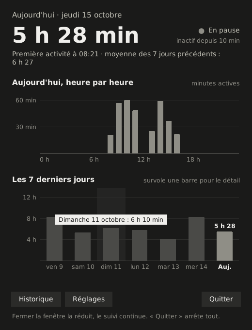
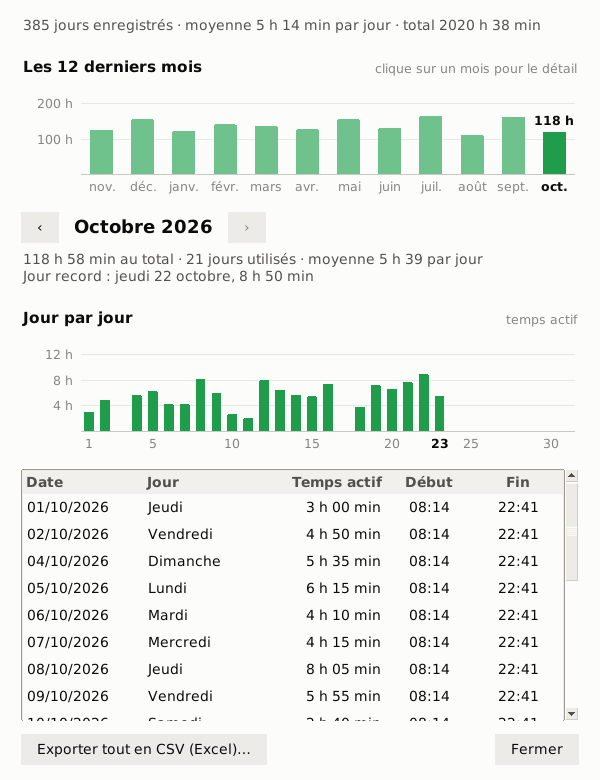

# Temps PC

Petite application Windows qui compte le temps passé **chaque jour** sur l'ordinateur.

Seul le temps **actif** est compté : après quelques minutes sans souris ni clavier, le compteur se met en pause et retire ces minutes d'inactivité. La veille du PC n'est pas comptée non plus.

<p>
  
  
</p>

## Ce qu'elle fait

- Temps du jour en grand, graphique **heure par heure** et graphique des **7 derniers jours**. Survole une barre pour voir le détail.
- **Vert** quand tu utilises le PC, **gris** quand le compteur est en pause.
- L'icône dans la barre des tâches **affiche le temps du jour** (ex. « 5h » au-dessus de « 28 »), mise à jour chaque minute.
- **Historique** : histogramme des 12 derniers mois (clic sur un mois pour le détail), le mois choisi jour par jour, tableau des jours et export CSV pour Excel.
- Démarrage automatique avec Windows (proposé au premier lancement, modifiable dans Réglages).
- Fermer la fenêtre la réduit, le suivi continue. Le bouton **Quitter** arrête tout.
- Thème clair ou sombre selon Windows.




## Installation

1. **[Télécharge TempsPC.zip](https://github.com/vincentschoebrechts-beep/temps-pc/raw/main/telechargement/TempsPC.zip)** (Windows 10/11, 64 bits, environ 10 Mo).
2. Clic droit sur le zip → **Extraire tout…**, puis place le dossier `TempsPC` là où il restera (par ex. Documents).
3. Double-clique sur `TempsPC.exe`.

Rien d'autre à installer : Python est inclus dans l'exe.

L'exe n'est pas signé : Windows peut afficher « Windows a protégé votre ordinateur ». Clique sur **Informations complémentaires**, puis **Exécuter quand même**.

### Mise à jour

1. Dans Temps PC, clique sur **Quitter**.
2. Remplace l'ancien `TempsPC.exe` par le nouveau, **au même endroit** (pour garder le démarrage automatique).
3. Relance `TempsPC.exe`. Les données sont conservées.

## Données

Tout reste sur le PC, dans `%APPDATA%\TempsPC\donnees.json` (bouton « Ouvrir le dossier » dans Réglages). Rien n'est envoyé sur Internet.

Copies de sécurité automatiques dans `%APPDATA%\TempsPC\sauvegardes` : une par jour (les 14 dernières sont gardées) et une copie permanente avant chaque nouvelle version.

## Versions

- **1.1** : Historique avec histogrammes (12 derniers mois et mois jour par jour), copies de sécurité automatiques, fenêtres adaptées aux petits écrans.
- **1.0** : première version.

## Lancer depuis le code source

Avec [Python 3](https://www.python.org/downloads/) installé (cocher « Add python.exe to PATH ») : double-clic sur `temps_pc.pyw`. Aucun module à installer. Fonctionne aussi sur macOS et Linux.

## Construire l'exe soi-même

Sur Windows, avec Python installé, dans le dossier du dépôt :

```bat
construction\construire.bat
```

Le fichier `dist\TempsPC.exe` est créé (PyInstaller, un seul fichier, sans console).
